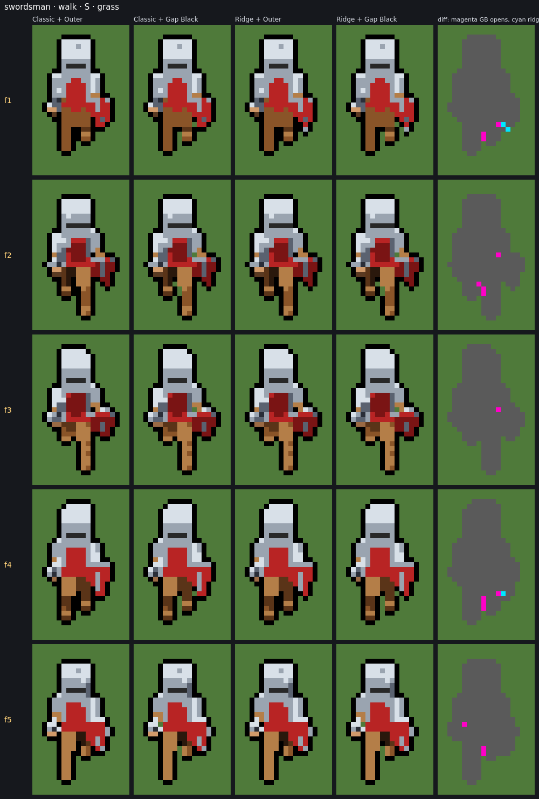
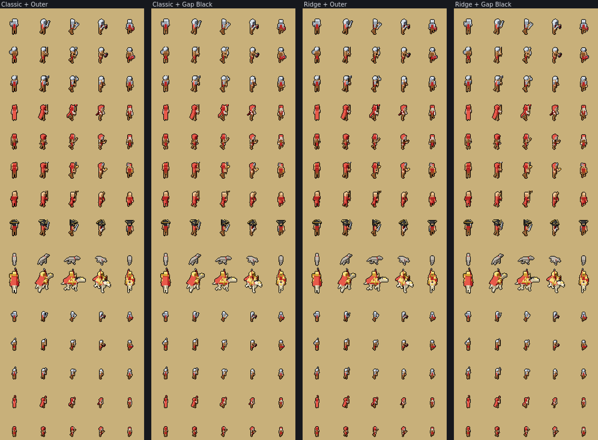
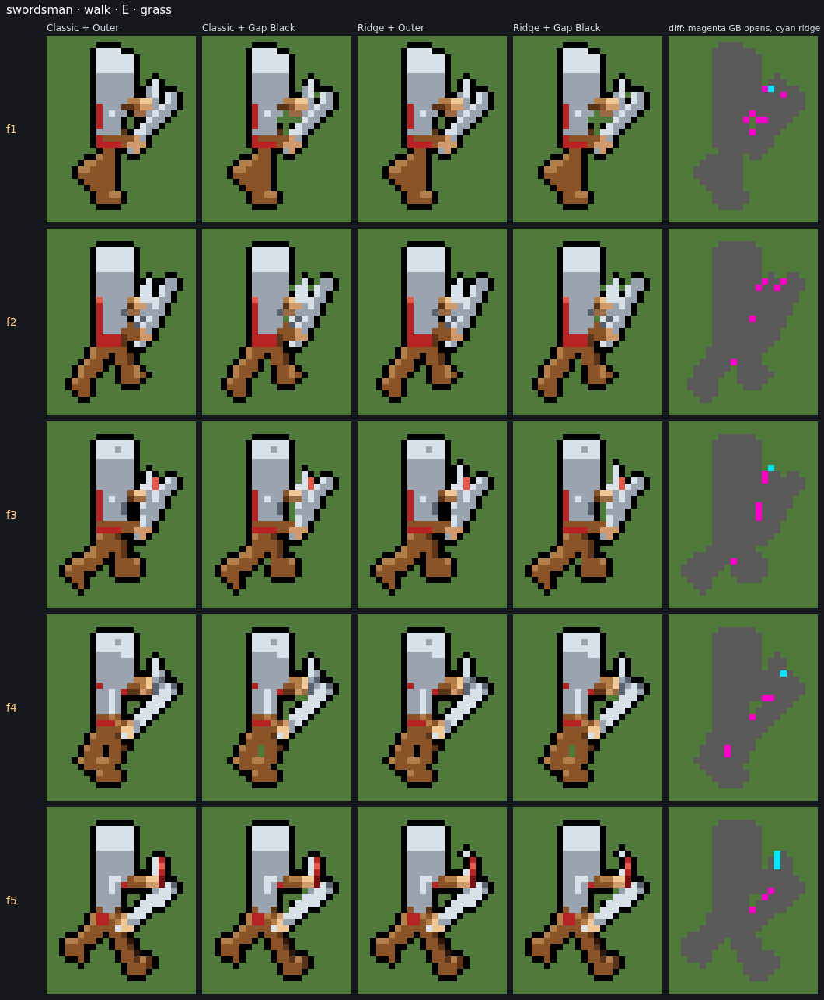
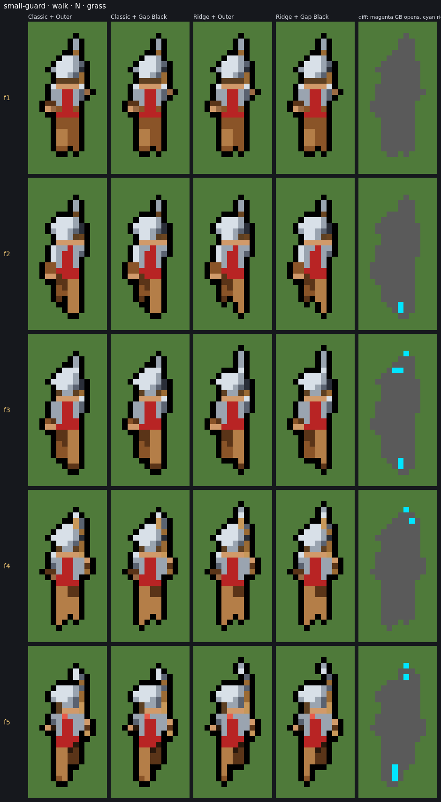
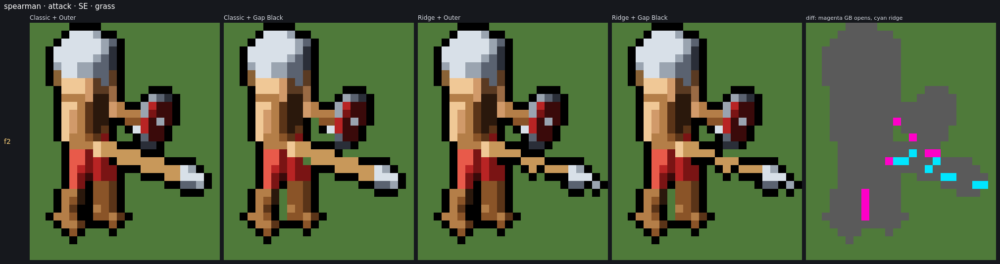

# Final visual validation: downsampling and outline for RTS readability

This follows [QUALITY_EXPERIMENTS.md](QUALITY_EXPERIMENTS.md). It is a gameplay-readability check of the two strongest candidates against the original pipeline. **No rendering code, defaults or share-link handling were changed.** Tests (26 files, 560 tests), `tsc --noEmit` and `npm run build` all pass. The only change to the working tree is the new `shots/final-validation/` folder and this report.

## Verdict

| Question | Answer |
|---|---|
| Default downsampling | **Ridge.** No regression found at the default scale. Thin weapons get steadier and flicker drops slightly. |
| Default outline | **Gap Black**, after one small fix (single-pixel holes, below). |
| Change defaults now? | **No.** Two things have to land first: the 1 px hole fix, and a share-link version bump, because v2 links omit default values and would silently re-render. |
| Blocking limitations | (1) Gap Black leaves enclosed **1 px holes** open. They read as speckle and blink from frame to frame. (2) Share-link compatibility for a default change. |
| Non-blocking limitations | Ridge thins feet by ~1 px at 9 px/unit. Gap Black lets a little more of the sprite touch the ground directly (luma-close edges: grass 0.2% → 3.1%). |

At normal game zoom (1×–2×), **all four configurations read almost the same**. The differences are pixel-level, and most only show at 6× or more. Nothing here is a reason to avoid the candidates. Ridge + Gap Black is the best of the four, but not by a large margin.

## 1. Benchmark

Rendered by the app itself (dev server, `?diag`, headless Firefox) as the `FrameSamples` it shades, then shaded offline with the app's own `shadeStages`. All four configurations shade **the same samples**, so camera, scale, pose, frame timing and dithering are identical by construction. Settings are the app's defaults: 32 px frame, 14 px/unit, 8× supersampling, coverage 0.3, default thresholds, team red unless noted.

| Unit (preset, seed 1) | What it tests | Rows |
|---|---|---|
| swordsman | benchmark; sword + kite shield; steel | walk, idle |
| spearman | spear + round shield; leather | walk, idle, attack |
| guard | halberd (thin diagonal polearm) | walk, idle, attack |
| mage | staff; **pale skin, bone beard** | walk, idle |
| archer | bow (thin curve + string); pale skin | walk, idle |
| militia | pitchfork + torch | walk, idle |
| monk | crook; robe; holy | walk, idle |
| pirate | **dark hair**, tricorn, sabre | walk, idle |
| wolf | quadruped legs, tail; fur | walk, idle |
| mounted knight, 48 px | lance; **bone (pale) horse**; legs crossing | walk, idle |
| small swordsman / spearman / guard / mage / archer | **9 px/unit** (small scale) | walk, idle |
| swordsman, mage, knight in the **white** team; swordsman, pirate in the **black** team | pale and dark team materials | walk, idle |

That makes 15 units, 32 rows, all **5 rendered directions** (N, NE, E, SE, S; the west-facing ones are mirrors), walk 5 frames, idle 4, attack 5: **725 frames** per configuration. No new models were added; all are existing presets.

## 2. Comparison sheets

Saved under [shots/final-validation/](shots/final-validation/):

- **[sheets/](shots/final-validation/sheets/)** (126 files), `<unit>-<row>-<ground>[-team_<team>].png`. Each has every direction. Per direction there are four rows: **Classic + Outer, Classic + Gap Black, Ridge + Outer, Ridge + Gap Black**. Each row shows all consecutive frames at 3× (2× for 48 px), then the same frames at 1×. Grounds: grass `#4f7a3a`, sand `#c8b07a`, dark `#1c1f24`.
- **[field/](shots/final-validation/field/)** is the game-scale view. All 15 units × 5 directions, side by side in the four configurations, at 1× and 2×, for walk and idle on each ground. The `*-2x.gif` files play the cycle at the rows' own frame rates (walk 8 fps, idle 4 fps), to judge motion.
- **[edge-cases/](shots/final-validation/edge-cases/)** has focus views: one unit/row/direction, the four configurations side by side at 6–16×, cropped to the sprite. The fifth panel marks the differences: **magenta** = ground that Gap Black leaves open where Outer draws black, **cyan** = silhouette pixels Ridge changes.

## 3. Readability

### Measured over all 725 frames

Change per frame step, summed over the 32 rows (Classic + Outer = 3545.5 px/step):

| | Classic + Outer | Classic + Gap Black | Ridge + Outer | Ridge + Gap Black |
|---|---|---|---|---|
| px changing per frame | 3545.5 | **+0.76%** | **−0.53%** | **+0.22%** |
| per-row range vs Classic + Outer | — | −0.1 … +2.7% | −2.7 … +1.4% | −1.4 … +3.3% |
| edge contrast, grass (mean \|Δluma\| / edge px lost) | 0.398 / 0.2% | 0.378 / 3.1% | 0.398 / 0.2% | 0.378 / 3.1% |
| edge contrast, sand | 0.690 / 0.3% | 0.651 / 1.9% | 0.690 / 0.3% | 0.653 / 1.8% |
| edge contrast, dark | 0.123 / 0.0% | **0.145** / 0.7% | 0.123 / 0.0% | **0.144** / 0.6% |

Per row at the default scale, Gap Black keeps **25–50% of narrow-gap pixels open** (Outer: 0). Examples: swordsman walk 3.9 of 10.7, mage walk 6.1 of 12.4, guard walk 6.3 of 13.8, wolf walk 1.0 of 4.2. It fills ~1 px/frame of gaps and holes with black, against Outer's 6–10 at the default scale, and closes 70–90% of one-pixel dents. At 9 px/unit there are fewer gaps to begin with (3–7 per frame), and Gap Black keeps 0.5–2.8 of them open.

Ridge against Classic, before outlining:

| | Classic | Ridge |
|---|---|---|
| isolated pixels (8-connected singletons), all frames | 1 | **0** |
| separate pieces, all frames | 729 | 729 |
| drawn area | 118,207 px | −0.63% (870 removed, 120 added) |
| bounding box changed | — | 55 of 725 frames, always by 1 px |
| 1 px-wide pixels per frame (e.g. mage walk) | 4.2 | 7.0 |

### By question

- **Limbs stay visually separated:** better with Gap Black. Outer fills the gap between crossing legs, between arm and body, and between a polearm and the legs with black. In motion that reads as one dark mass. Gap Black shows ground there.
  - swordsman walk E f3 (arm–body) and f4 (knee gap)
  - mage walk E f1–f5 (a full-height strip between the staff and the robe)
  - guard attack SE f3, f5 (halberd shaft against the legs)
  - knight walk E f4 (horse's front legs)

  At 1× the difference is small. At 2× it is visible as "legs" rather than "a block".
- **Weapons recognisable at small scale:** better with Ridge.
  - Spear, staff, lance and halberd shafts stay a steady 1 px; Classic switches between 1 and 2 px and draws the spear as a plank.
  - At 9 px/unit, Classic shrinks the guard's halberd blade to a nub in walk N f3–f5. Ridge keeps it visible and 1 px taller.
  - The outline mode has no effect here: neither outline changes the silhouette.
- **Silhouette details lost:** none, in any configuration. Ridge never splits a part off or leaves an isolated pixel. Its extra 1 px is always a weapon tip, ear or tail getting a pixel back.
- **1 px holes and dents:** mixed. See failure F1.
  - Gap Black closes dents (notches), as designed, so the ring stays continuous.
  - Elongated slits (2–4 px: between legs, staff and body) look **intentional**.
  - Enclosed **1 px holes** look **accidental**.
- **Readable on all three grounds:** yes, in every configuration.
  - Grass and sand: the black ring keeps every unit, including the white team and the pale horse, clearly bounded.
  - Dark ground: the ring is low-contrast in every configuration (black on `#1c1f24`), and units read by their lit interiors. Gap Black is actually slightly better there (0.145 vs 0.123), because the open gaps show lit pixels.
  - The extra "lost" edge pixels under Gap Black are lit leather on grass, light wood/skin on sand, and the red team's darkest shade on dark ground. All of them sit beside small gaps whose other edges stay black, and hue still separates them (the metric is luma only).
- **Ridge isolated pixels or changed proportions:** no isolated pixels at all. The proportion changes are limited to failure F3 (small feet) and the 1 px tip changes noted above.
- **Stable animation:** all four are within ±3% per row, and the GIFs look equally stable. Ridge is slightly calmer, because shafts stop switching width. Gap Black's only visible instability is the 1 px holes blinking (F1).

## 4. Edge cases and documented failures

| Case | Where to look | Finding |
|---|---|---|
| One-pixel dents | every sheet; dents ≈ 3–9 per frame | Gap Black closes 70–90% of them. The ring stays continuous, with no ragged notches. ✔ |
| One-row / narrow gaps | swordsman walk S f1, f2, f4, f5; guard attack SE f1, f2 | 1×2 / 1×3 slits between the legs stay open with Gap Black. They read as intentional. ✔ |
| Enclosed holes ≤ 4 px | found in **235 of 725 frames** (32%); size 1: 147 holes, 2: 93, 3: 48, 4: 19 | Holes of 2–4 px that sit between parts read well when open (swordsman walk E f3, f4). **1 px holes fail: F1.** |
| Thin diagonal weapons | spearman attack E/SE, guard attack SE, knight lance | Ridge gives a clean 1 px stepped line (F4: judged a gain). Both outlines ring it identically. ✔ |
| Arms over the torso | swordsman walk E f1–f3; spearman attack E f1, f3, f5 | Arm separated from the body by a ground slit with Gap Black, a black bar with Outer. ✔ apart from 1 px holes (F1) |
| Legs crossing | swordsman walk E f4; archer walk E f4; knight walk E f4 | Gap Black keeps a ground pocket between the legs, where Outer draws a black blob. ✔ |
| Pale skin and bone on bright/dark grounds | mage on sand/dark, archer on sand, white team on sand, bone horse on sand | Readable in all four configurations, because the black ring is kept. ✔ |

### F1: Gap Black leaves 1 px enclosed holes (blocking for a default)

The rule leaves enclosed holes of up to 4 px unoutlined. That works for 2–4 px pockets between parts. Single-pixel holes, however, appear in tight clusters (hand + hilt, bow + hand, arm + shoulder) as ground-coloured specks inside the sprite:

- 1 px holes occur in **123 of 725 frames (17%)**.
- **Only 18 of 147 (12%) are still there in the next frame**, so they blink.
- They are most visible on sand, where a light speck reads like a stray highlight. On grass they are subtle; on dark ground they are invisible.

Outer turns the same pixel black, which reads as interior shading.

Frames:

- **swordsman walk E f1** (5 specks in the sword-hand cluster) and **f2** (4)
- **archer walk E f1, f4** (bow hand, on sand)
- **spearman attack E f1** (a 2×2 hole plus specks between the spear arm and the face)
- **mage walk E f4, f5** (inside the robe and beard)

**Fix, prototyped outside `src/` only:** fill enclosed holes of exactly 1 px with black, and keep 2–4 px holes open.
- Flicker: +3 changed px out of 80,306 over all rows, i.e. none.
- It removes the specks and keeps the arm slit (f3) and the gap between the legs (f4) open.
- Comparison: [edge-cases/prototype-fill-1px-holes-swordsman-walk-E-sand.png](shots/final-validation/edge-cases/prototype-fill-1px-holes-swordsman-walk-E-sand.png).

In the code this is a one-line change to the `smallHole` rule in [src/render/gapOutline.ts](src/render/gapOutline.ts), with a test.

### F2: Gap Black exposes a few low-contrast sprite edges (minor, accept)

Where a gap stays open, the sprite pixels beside it face the ground with no outline. Those within 0.08 luma of the ground rise from 0.2% to 3.1% of edge pixels on grass, and from 0.3% to 1.9% on sand. Example: the lit side of the mage's staff on sand, mage walk E f2–f3. Each such gap is only 1–2 px, and its other side is still black, so the part stays readable. This is the inherent cost of opening gaps and doesn't need a fix.

### F3: Ridge thins feet at 9 px/unit (minor, accept or tune later)

At 9 px/unit the legs are about 1.5 px wide, right at Ridge's `THIN` limit. Ridge therefore draws some foot and ankle rows 1 px instead of 2. Of the pixels Ridge removes on the small units, 25–30 per row set (≈0.6 px/frame) are in the **bottom quarter** of the sprite; at the default scale it is ≈0.

Frames: **small-guard walk N f2, f3, f5**; **small-mage walk SE f5** (width 10 → 9).

It is consistent across frames, and small-unit flicker goes *down* with Ridge (−0.2 … −1.4% for walks), so it reads as slightly slimmer feet, not jitter.

### F4: Ridge stair-steps thin diagonals (not a failure)

**spearman attack SE f2**: Classic draws the shaft as a 2 px band. Ridge draws it as a 1 px line that steps diagonally where it leaves the forearm, and the spearhead gains a 1 px point (bbox 19 → 20). The line stays 8-connected and reads more like a spear. This is the intended behaviour.

### Found along the way, not caused by any of the four modes

- **spearman attack E f2–f5**: the spear reaches the frame's right edge, so its tip and outline are cut off. This is a framing / frame-size issue, the same in every configuration.
- **Pure black is both the outline and the `dark` ramp's shade 0.** Dark hair in shadow (pirate, black team) merges with the outline, the same under Outer and Gap Black.
- **QUALITY_EXPERIMENTS.md lines 165–184** contain a leftover Python editing snippet in the middle of the document. It is untouched here, but should be removed.

## 5. Recommendation

1. **Downsampling: make Ridge the default.** It is neutral or better on every measure here:
   - no isolated pixels or broken parts
   - steadier weapons
   - −0.5% flicker
   - the only change at small scale is slightly slimmer feet

   It can change independently of the outline.
2. **Outline: make Gap Black the default after fixing F1.** It keeps the outer outline's strong, continuous black edge (best of the four on dark ground), costs +0.2–0.8% flicker, and opens limbs and weapons where Outer fuses them.
3. **Do not change the defaults yet.** Keep every mode, including the diagnostics. Before switching:
   - **Fix F1** (fill 1 px enclosed holes) and re-run this benchmark.
   - **Share links.** v2 links record only values that differ from `SHARE_DEFAULTS`. A link made with today's default (`outline: 'inner'`, `downsample: 'classic'`) has no `outline` field, so it would silently render with the new default. Changing defaults therefore needs a v3 link, with v2 links decoded against the old defaults (`inner` + `classic`).
   - **The current default is `inner`, not `outer`.** Moving to any outer outline adds a 1 px ring outside the silhouette. Every default sheet changes look, and parts touching the frame edge (spearman attack E, above) lose their outline there. This is a deliberate style decision, beyond the Outer vs Gap Black comparison.

## Reproducing

1. Run the dev server (`npm run dev`), open `/?diag&s=<link>` for each preset above, and dump `ssheetDev.diagnostics.src.rows()`.
2. Shade the dump with `shadeStages` in each configuration.
3. The metrics use `stageStats` and `edgeContrast` from [src/render/diagnostics.ts](src/render/diagnostics.ts), and `holes` from [src/render/gapOutline.ts](src/render/gapOutline.ts).

The diagnostics panel's **compare** mode shows the same comparisons interactively.
