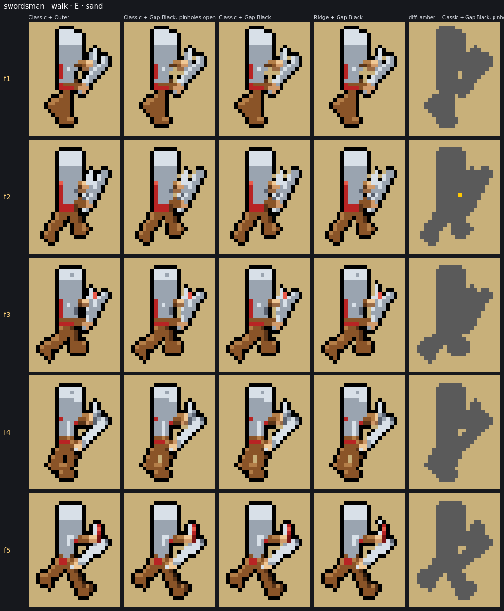
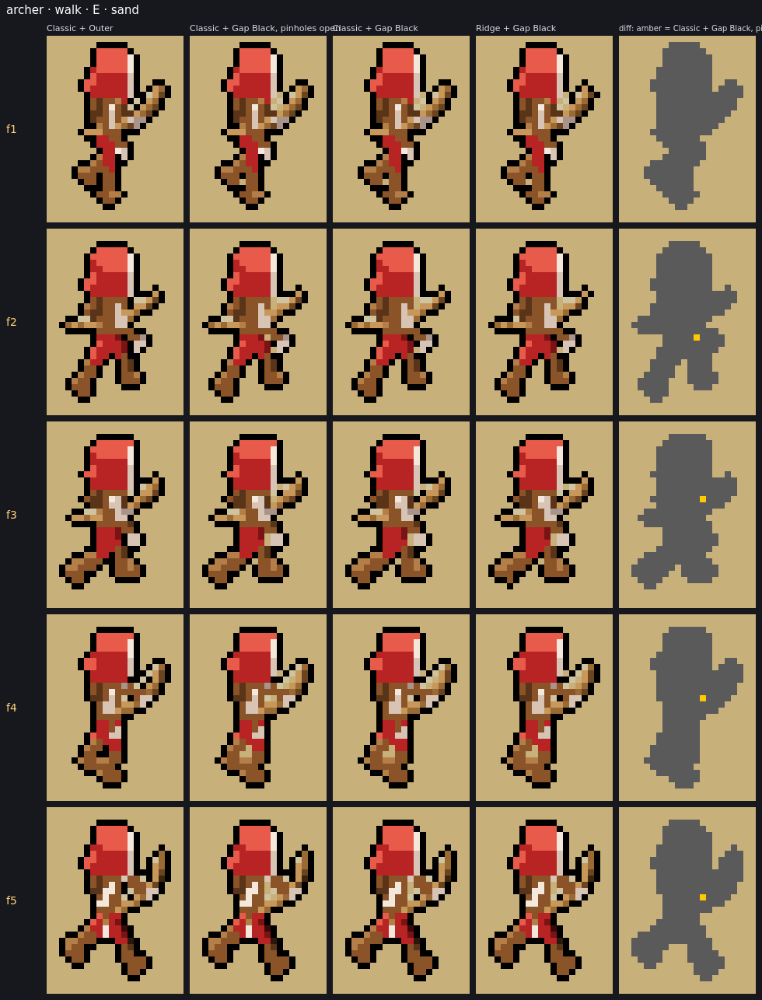

# Final visual validation, part 2: Gap Black pinholes, and a repeatable benchmark

This follows [FINAL_VISUAL_VALIDATION.md](FINAL_VISUAL_VALIDATION.md).

- **Part A** fixes the blocking issue found there (F1): Gap Black leaving enclosed single-pixel holes open.
- **Part B** moves the benchmark into the repository.
- **Part C** re-runs it and compares the results with the first validation.

## Summary

- **Single-pixel holes:** 147 → **9** (−94%); frames with one: 123 → **5**. The 9 left are holes that ground passes *through*, which is deliberate (see A).
- **Useful gaps:** unchanged. Gaps between separate parts open: 9.3 → 9.3 px/frame (Classic), 8.0 → 8.0 (Ridge). The invariant "gap pixels between parts closed by the fill" is 0.
- **Flicker:** unchanged. +0.3 px/step over all 32 rows on Classic + Gap Black (3572.3 → 3572.6), +0.4 on Ridge + Gap Black (3553.4 → 3553.8). That's ±0.01%, and every row moves by at most 0.3 points.
- **Silhouette and thin parts:** unchanged. 0 silhouette pixels differ from Outer, the 1 px-wide counts are identical, and Ridge's statistics are identical. Every pixel the fix changes is a 1 px hole turned black, which the outer outline also draws.
- **Benchmark:** `npm run bench:visual`. It reproduces the first validation **exactly**: every metric, and every image pixel for pixel when run with the old Gap Black. Two full runs on this machine produce byte-identical output (220 files).
- **Correction to part 1:** its main F1 example (swordsman walk E f1) was not single-pixel holes. See C.3.
- **Not changed:** defaults, share-link encoding, decoding and versioning, animation timing, camera, 3D rendering, diagnostics, and the other outlines (Outer, Inner, Colored, Stable Colored) and downsampling modes. Nothing is committed.

## Part A: filling Gap Black's pinholes

### Why the prototype's rule wasn't used

The part 1 prototype filled every enclosed hole of exactly 1 px, i.e. a transparent pixel with drawn pixels on all four sides. That also catches **diagonal channels**. Take two parallel diagonals, such as a leg beside a cloak or a spear beside an arm:

```
.X.X....
..X.X...      every '.' between the two lines has drawn pixels on all four sides,
...X.X..      so holes() reports each as a 1 px hole on its own
```

Filling them closes exactly the kind of gap Gap Black exists to keep. The benchmark has a real one: **small mage walk E f5**, a diagonal line of ground between the cloak and the leg.

### The rule

A **pinhole** is a transparent pixel with drawn pixels on all four sides (an enclosed 1 px hole) that **no ground passes through**.

Ground can still reach such a pixel diagonally, through its corners:
- One reached through **at most one corner** is a dead end, and is filled.
- Filling it can make a neighbour a dead end, so the test repeats until nothing changes (leaf peeling of the background's 8-connected graph).
- An enclosed speck, a chain of specks, or a crack leading in from outside to nowhere is filled whole.
- A pixel that ground passes through, corner to corner, linking other ground stays open: a diagonal channel between two open areas, or a loop.

Why this is safe:

- **It can't close a gap between parts.** A pinhole's four drawn sides touch each other diagonally, so by Gap Black's own definition (sides that join within one step) it is a dent, never a gap between separate parts.
- **It can't cut ground off.** Only dead ends are removed, and bigger holes, slits and the background never are. So any two pieces of ground that were joined (8-way) stay joined.
- **It's deterministic.** The result doesn't depend on the order of filling.
- **It stays within Outer.** Each filled pixel becomes black, which the outer outline also draws there.

### Implementation

[src/render/gapOutline.ts](src/render/gapOutline.ts):

- New exported `pinholes(frame, holes?)` returns a mask. It is computed once per frame, from the `holes()` map Gap Black already builds.
- In `gapBlackOutline`, one step before the existing small-hole rule: a pinhole is set to black. Nothing else in the algorithm changed (dent depth, gap sides, small holes, larger holes).
- New option `fillPinholes` (default `true`). `false` gives the previous behaviour; the benchmark uses it as a reference.

Cost: one pass over the 1 px holes, a handful per frame.

**Note on share links:** encoding and decoding are untouched. A link that already selects `outline: gapBlack` will render with pinholes filled, because the mode itself changed; that is the purpose of this task. Links without it are unaffected, since the default is still `inner`.

### Tests

10 new tests in [test/gapOutline.test.ts](test/gapOutline.test.ts), under *gap-preserving black outer outline › pinholes*. Each is a hand-drawn frame:

| Test | Case |
|---|---|
| enclosed single-pixel hole | filled, and equal to the outer outline; open with `fillPinholes: false` |
| shut in on four sides, one corner opening outside | filled (a dead end) |
| a pair of specks touching at a corner | both filled |
| a chain of three, and a 2 px crack leading in from outside | filled whole, not just the ends; checks the `pinholes()` mask |
| **diagonal channel** between parallel diagonals | stays open; asserts `holes()` does report its pixels as 1 px holes |
| **exterior gaps**: a slit open to the outside, gaps between parts (`.X.X.`, `X..X`, vertical) | unchanged |
| **one-pixel dents** in an edge | outlined exactly as before |
| **narrow limb gaps**: a 1×2 hole (an arm loop), a 2×2 hole | stay open |
| **diagonal edges**: a stair-stepped wedge, a thin diagonal spear | unchanged, and still equal to the outer outline |
| property, random frames | nothing changes but 1 px holes, to black, where the outer outline is black too; the sprite is untouched |

The existing tests, including the outer outline's golden hashes and the Colored / Stable Colored tests, pass unchanged. Total: 26 files, **570 tests**.

## Part B: the benchmark in the repository

[bench/visual/](bench/visual/), documented in its [README](bench/visual/README.md):

| File | |
|---|---|
| `presets.mjs` | the 15 units (existing presets, seed 1), their rows, the team variants |
| `capture.mjs` | headless Firefox over WebDriver BiDi: opens each unit as a `?diag` share link, saves the rendered `FrameSamples` |
| `run.mjs` | the entry point: starts Vite's dev server on a free port (Vite API, no separate process), captures, then loads the TypeScript steps through the same server (`ssrLoadModule`) |
| `lib.ts`, `render.ts`, `metrics.ts` | shading with the app's own `shadeStages`; sheets, field views and GIFs, edge cases; metrics |
| `tsconfig.json`, `node.d.ts` | typecheck with `npx tsc -p bench/visual/tsconfig.json`; the few Node APIs used are declared locally, so no `@types/node` dependency |

Design points:

- **Optional.** Nothing in `src/` imports it, and the production bundle contains none of it (checked).
- **No new dependencies.** It uses Vite (already a dev dependency) and the app's own modules.
- **External tools, documented, nothing silently assumed:**
  - Firefox is required (WebGL rendering). Override the executable with `--firefox` or `FIREFOX`; the script fails with a clear message if Firefox doesn't come up.
  - ImageMagick 7 is optional (labels, 2× views, GIFs). Without it, images are written unlabelled.
- **Same as part 1.** The same 15 presets, rows, frame counts and settings; all 5 directions; all consecutive frames; grass, sand and dark; and the four configurations. The metrics add Gap Black with pinholes open as a reference column.
- **Output** goes to `bench-output/visual/` (~32 MB), which is added to `.gitignore`. Only four small comparison images (124 KB) were copied to [shots/pinholes/](shots/pinholes/) for this report.
- **Deterministic.** `manifest.json` lists the SHA-256 of every file. Across machines, GPU and driver differences could change the captured samples slightly; the README says to compare `metrics.md` then.

## Part C: validation

| Check | Result |
|---|---|
| `npm test` | 26 files, 570 tests passed |
| `npx tsc --noEmit` | passed |
| `npm run build` (typecheck + Vite build) | passed |
| `npx tsc -p bench/visual/tsconfig.json` | passed |
| `npm run bench:visual`, twice from scratch | passed, 92 s each; 220 files, **all hashes identical** between the runs |

### C.1 The benchmark reproduces part 1

Pinholes-open columns, against the figures in FINAL_VISUAL_VALIDATION.md:

| | Part 1 | This benchmark |
|---|---|---|
| Classic + Outer, px changing per step (sum over 32 rows) | 3545.5 | 3545.5 |
| Classic + Gap Black / Ridge + Outer / Ridge + Gap Black | +0.76% / −0.53% / +0.22% | +0.76% / −0.53% / +0.22% |
| edge contrast, Gap Black, grass · sand · dark | 0.378/3.1% · 0.651/1.9% · 0.145/0.7% | identical |
| frames with an enclosed hole ≤ 4 px | 235 of 725 | 235 of 725 |
| holes by size 1 / 2 / 3 / 4 | 147 / 93 / 48 / 19 | 147 / 93 / 48 / 19 |
| 1 px holes: frames, still there next frame | 123, 18 of 147 | 123, 18 of 147 |
| Ridge: isolated px, pieces, area, bbox changes | 1→0, 729→729, −0.63%, 55 | 1→0, 729→729, −0.63%, 55 |

Images: rendered with the old Gap Black (`fillPinholes: false`), all 126 sheets and 12 field frames are **pixel-identical** to the committed [shots/final-validation/](shots/final-validation/). The 13 edge-case views are identical below their header line, where only the legend text was reworded.

### C.2 Before and after the fix

Pinholes-open values first, then filled; sums over 32 rows, per frame:

| | Classic + Gap Black | Ridge + Gap Black |
|---|---|---|
| enclosed 1 px holes left open (all frames) | 147 → **9** | 144 → **9** |
| frames with one | 123 → **5** | 121 → **5** |
| px changing per frame step | 3572.3 → 3572.6 | 3553.4 → 3553.8 |
| narrow-gap px open | 126.9 → 120.9 | 125.0 → 119.1 |
| … between separate parts, open | 9.3 → **9.3** | 8.0 → **8.0** |
| … dents, open | 31.6 → 25.6 | 32.2 → 26.3 |
| edge sides left bare | 237.2 → 213.3 | 232.4 → 209.0 |
| outline px filling gaps or holes | 32.8 → 38.8 | 32.3 → 38.1 (Outer: 188 / 183) |
| edge px lost on grass · sand · dark | 3.1 · 1.9 · 0.7% → 2.8 · 1.7 · 0.6% | 3.1 · 1.8 · 0.6% → 2.8 · 1.6 · 0.5% |
| 1 px-wide px, silhouette | unchanged (127.6) | unchanged (170.8) |

Invariants over all 725 frames, both coverages; all **0**:

- Gap Black outline pixels Outer wouldn't draw
- Gap Black pixels that differ from pinholes-open anywhere but a 1 px hole
- silhouette pixels that differ from Outer
- gap pixels between parts closed by the fill

114 of the 126 sheets change, each only by the filled pixels.

Where the 9 that remain are (all of them pass ground through, so the rule keeps them):

- **archer walk E f1, f4; archer idle E f2, f3:** 2 px diagonal cracks in the bow hand, open to the outside at both ends.
- **small mage walk E f5:** the diagonal channel between cloak and leg. Keeping this one open is the purpose of the rule.





More in [shots/pinholes/](shots/pinholes/) (spearman attack E, mage walk E) and, after a run, `bench-output/visual/edge-cases/pinholes-*.png`.

### C.3 Correction to part 1, and the remaining specks

Part 1 gave **swordsman walk E f1** ("5 specks in the sword-hand cluster") as its main example of F1, and said the prototype removed most of them. That was wrong.

- Those pixels are not single-pixel holes. 5 of them are the narrow parts of an **enclosed hole of 5+ px** in the hilt and hand, which Gap Black keeps open on purpose ("bigger holes are outlined inside except where they're narrow"). The other 2 are slit pixels open to the outside.
- The fix (like the prototype) changes one pixel in that sequence, in f2.
- Part 1's figures for single-pixel holes (17% of frames, 12% persisting) were right. Of its other examples:
  - **Genuine pinholes, now filled:** archer walk E f2–f5 (in f4, 1 of 3; the other 2 pass ground through) and spearman attack E f3.
  - **Mage walk E:** its only pinhole is in f2. The f4–f5 specks part 1 pointed to are 2–4 px holes and slit pixels.
  - **Spearman attack E f1:** the 2×2 hole is 4 px, kept open by the small-hole rule, as before.

Ground pixels Gap Black leaves open where Outer draws black, over all 725 frames (Classic, after the fix):

| kind | px |
|---|---|
| gaps open to the outside (slits, between parts) | 1902 |
| narrow parts of enclosed holes of 5+ px | 413 |
| enclosed holes of 2 px / 3 px / 4 px | 186 / 144 / 76 |
| enclosed holes of 1 px (pass-through only) | 9 |

So the speckle that remains in dense clusters (hand + hilt, bow hand) comes from **2–4 px holes and the narrow parts of bigger holes**, not from single-pixel holes. It is smaller and rarer than the pinholes were, and comes from rules that decide what counts as a gap. Changing it would mean changing those rules (the small-hole size, or how narrow parts of holes are treated), which this task excluded.

## Recommendation, updated

- **F1 is resolved for single-pixel holes.** The pinhole fix removes 94% of them, with no flicker cost and no gap, silhouette or thin-feature change.
- **Ridge + Gap Black remains the recommended future default.** Before switching:
  - The **share-link versioning** described in part 1 is still required.
  - Optionally, look at the remaining cluster specks (C.3). For example, test treating 2 px holes like pinholes, using this benchmark's `pinholes-*` views and metrics to judge it.
- **Defaults are unchanged** (`inner`, `classic`).

## Changed files

| File | Change |
|---|---|
| `src/render/gapOutline.ts` | `pinholes()` and the fill step in `gapBlackOutline`, option `fillPinholes` |
| `test/gapOutline.test.ts` | 10 pinhole tests |
| `package.json` | script `bench:visual` (no dependency changes) |
| `.gitignore` | `bench-output` |
| `bench/visual/README.md`, `presets.mjs`, `capture.mjs`, `run.mjs`, `lib.ts`, `render.ts`, `metrics.ts`, `node.d.ts`, `tsconfig.json` | the benchmark (new) |
| `shots/pinholes/*.png` | 4 comparison images for this report (new, 124 KB) |
| `FINAL_VISUAL_VALIDATION_PART2.md` | this report (new) |

**Reproduce the benchmark** (needs Node ≥ 22, Firefox; ImageMagick 7 optional):

```sh
npm install && npm run bench:visual
```

Output in `bench-output/visual/`, with the totals in `bench-output/visual/metrics.md`.
