# Quality experiments: ridge-preserving coverage and outer outlines that keep gaps open

- **Part 1:** the first two experiments proposed in [PIPELINE_AUDIT.md](PIPELINE_AUDIT.md) (§4 A and §5 1), ridge-preserving coverage and the colored outer outline. Both are implemented as opt-in options and compared against the original pipeline on the same rendered frames.
- **[Part 2](#part-2-outline-refinement-temporal-stability-and-gap-preservation):** two refinements of the outline that came out of Part 1, the stable colored outline and the gap-preserving black outline.

## What was added

| Setting (Sprite folder) | Values | Default |
|-------------------------|--------|---------|
| **downsample** | `classic` (the original), `ridge` | `classic` |
| **outline** | `none`, `inner`, `outer`, **`colored`** | `inner` (unchanged) |

- **Baseline kept exactly.** `outline()` (inner and outer) and the classic coverage threshold are untouched. The golden hashes of the original outer outline still pass byte for byte.
- **Old share links render as before.** Links record only what differs from the defaults, and the defaults haven't changed. A link using the new options, opened in an older build, falls back to that build's defaults, because `mergeSettings` skips unknown fields and values.
- **Same export formats.** Both options only change which palette indices pixels get. Coloured outline pixels next to team-coloured parts use the team ramp's darkest shade, so they recolour per player and appear in the team mask like any team pixel.
- Portraits and the effects sheet follow the same settings as the sheet, as before.
- Code: [src/render/ridge.ts](src/render/ridge.ts), [src/render/coloredOutline.ts](src/render/coloredOutline.ts), dispatched from `coverageMask` and `shadeStages` in [src/render/postprocess.ts](src/render/postprocess.ts).

### Ridge-preserving coverage

Pixels are decided per run instead of one at a time. Along each row, a run of covered pixels whose coverage adds up to **under 1.5 px** is a thin part's cross-section, provided the part goes on: a run in the row above or below that touches it is thin too. A thin cross-section draws exactly **one pixel**, its most covered (the first on a tie), if it adds up to at least half the coverage threshold. Columns work the same way. A pixel thin both ways (a part at about 45°) is drawn if either way picks it. Everything else, including lone specks and the partly covered last row of a thick part, keeps the classic threshold.

### Colored outer outline

The outline sits where the outer outline goes (outside the silhouette, 4-neighbour ring; the silhouette itself is unchanged), but:

- Next to a **lit** pixel (shade 2–3) it takes the **darkest shade of that pixel's material**. Next to a **shadowed** one (shade 0–1) it's **black**. So the outline follows the light: lighter on the lit side, black on the shadowed side. Bordering several pixels, the darkest decides.
- Materials whose darkest shade is too pale to read as an outline (luma > 0.3: pale skin, bone, holy) always get black.
- **Narrow gaps stay open.** A 1 px gap between parts isn't outlined; a 2 px gap is outlined only on its darker part's side (the left or upper one on a tie).

## How it was compared

- **Same frames:** all four configurations shade the **same `FrameSamples`**, from the same render, camera and settings (coverage 0.3, thresholds 0.4 / 0.62 / 0.86, 8× supersampling).
- **Diagnostics panel** (`npm run dev`, then `/?diag`). The new **compare** mode shows every frame of a direction in the four configurations, over grass, sand, dark ground or the checker, with their stats for that direction and for all of them. **⇘ shift frame 1 across a pixel** renders the previewed row's first frame 8 times, slid ⅛ px right and down each time. The pose doesn't change, so anything that changes is aliasing.
- **Units:** swordsman (benchmark), spearman, archer (plus its arrow and javelin effects), mage, worker, ghost, wolf, mounted knight (48 px), catapult (64 px), all 5 directions; plus the swordsman, spearman, archer and mage drawn small (9 px/unit instead of 14).
- **Synthetic lines:** bars 0.25–2 px wide at 13 angles and 24 sub-pixel offsets, to measure thin parts in isolation.

The metrics, per frame and averaged over the 5 directions:

| Metric | Meaning |
|---|---|
| dropped | pixels with some coverage that aren't drawn |
| 1 px wide | drawn pixels with nothing on both sides along a row or column |
| outline / black | outline pixels, and how many of them are pure black |
| narrow gaps open | empty pixels with parts 1–2 px away on both sides, and how many stay empty after outlining |
| changing | final pixels that appear, disappear or change colour from one frame to the next |

## Results

### Thin parts in isolation (synthetic bars, coverage 0.3, 8×)

For each width: slices drawn exactly 1 px, slices with gaps, and the jitter of the drawn total across sub-pixel offsets.

| width | classic | ridge |
|---|---|---|
| 0.25 px | gaps 91%, vanishes in 68% of positions | **1 px 99.8%**, never vanishes |
| 0.375 px | 1 px 80%, gaps 20%, broken in 76% of positions, jitter ±1.43 | **1 px 100%**, never broken, jitter ±0.34 |
| 0.5 px | 1 px 93%, gaps 6.5%, broken 30%, jitter ±1.28 | **1 px 100%**, jitter ±0.45 |
| 0.75 px | 1 px 76%, 2 px 24%, jitter ±1.42 | **1 px 99.8%**, jitter ±0.65 |
| 1 px | 1 px 48%, 2 px 52%, jitter ±1.47 | **1 px 97%**, jitter ±0.68 |
| 1.25 px | 1 px 22%, 2 px 78%, jitter ±1.68 | 1 px 81%, jitter ±0.68 |
| ≥ 1.5 px | as classic (by design) | |

### Real sprites (default scale unless noted)

Each cell lists the four configurations in order: **classic + outer / ridge + outer / classic + colored / ridge + colored**.

| row | dropped | 1 px wide | outline | black | narrow gaps open | changing / frame |
|---|---|---|---|---|---|---|
| swordsman walk (**benchmark**) | 30.2 / 30.4 / 30.2 / 30.4 | 2.0 / 2.7 / 2.0 / 2.7 | 79.2 / 79.6 / 72.0 / 72.4 | 79.2 / 79.6 / 18.0 / 18.1 | 0 · 0 · 7.1 · 7.2 of 10.7 | 138.7 / 139.0 / 147.0 / 147.0 |
| swordsman attack | 30.6 / 30.9 / 30.6 / 30.9 | 2.3 / 2.9 / 2.3 / 2.9 | 84.2 / 84.4 / 76.0 / 76.1 | 84.2 / 84.4 / 21.4 / 21.5 | 0 · 0 · 8.2 · 8.3 of 12.8 | 187.6 / 187.4 / 194.7 / 194.4 |
| spearman walk | 34.4 / 35.2 / 34.4 / 35.2 | 3.3 / 4.5 / 3.3 / 4.5 | 79.9 / 80.4 / 71.0 / 71.5 | 79.9 / 80.4 / 22.4 / 22.4 | 0 · 0 · 8.9 · 8.9 of 12.2 | 150.8 / 150.6 / 160.8 / 160.6 |
| archer walk | 31.9 / 32.2 / 31.9 / 32.2 | 2.9 / 3.3 / 2.9 / 3.3 | 74.0 / 74.0 / 65.9 / 66.0 | 74.0 / 74.0 / 24.3 / 24.5 | 0 · 0 · 8.0 · 8.0 of 9.9 | 129.7 / 129.9 / 136.4 / 136.7 |
| mage walk | 33.2 / 35.5 / 33.2 / 35.5 | 4.2 / 7.0 / 4.2 / 7.0 | 81.3 / 82.1 / 71.7 / 72.6 | 81.3 / 82.1 / 24.1 / 23.5 | 0 · 0 · 9.6 · 9.5 of 12.4 | 142.0 / 141.8 / 148.8 / 148.5 |
| worker work | 27.8 / 28.1 / 27.8 / 28.1 | 2.8 / 3.7 / 2.8 / 3.7 | 77.4 / 78.0 / 71.2 / 71.9 | 77.4 / 78.0 / 30.6 / 30.4 | 0 · 0 · 6.2 · 6.2 of 10.0 | 162.4 / 162.4 / 166.6 / 166.7 |
| ghost walk (see-through) | 30.3 / 31.2 / 30.3 / 31.2 | 3.3 / 4.5 / 3.3 / 4.5 | 77.2 / 77.4 / 71.5 / 71.8 | 77.2 / 77.4 / 26.6 / 26.9 | 4.0 · 3.9 · 7.0 · 6.8 of 8.0 | 208.1 / 207.7 / 203.4 / 203.2 |
| wolf walk | 23.9 / 24.2 / 23.9 / 24.2 | 2.9 / 3.6 / 2.9 / 3.6 | 54.7 / 55.1 / 51.8 / 52.2 | 54.7 / 55.1 / 9.1 / 9.0 | 0 · 0 · 2.9 · 2.9 of 4.2 | 57.8 / 57.6 / 61.5 / 61.4 |
| mounted knight walk, 48 px | 54.4 / 55.6 / 54.4 / 55.6 | 7.4 / 9.6 / 7.4 / 9.6 | 127.8 / 128.3 / 117.6 / 118.2 | 127.8 / 128.3 / 68.7 / 68.4 | 0 · 0 · 10.2 · 10.1 of 14.4 | 252.0 / 252.4 / 261.5 / 261.9 |
| catapult walk, 64 px | 39.6 / 40.4 / 39.6 / 40.4 | 5.2 / 6.8 / 5.2 / 6.8 | 108.3 / 109.1 / 101.6 / 102.2 | 108.3 / 109.1 / 23.0 / 22.9 | 0 · 0 · 6.7 · 6.9 of 9.7 | 98.2 / 98.1 / 104.2 / 104.3 |
| arrow effect | 8.8 / 12.2 / 8.8 / 12.2 | 2.0 / 5.4 / 2.0 / 5.4 | 28.0 / 29.2 / 27.6 / 28.8 | 28.0 / 29.2 / 5.0 / 4.4 | — | — |
| arrow effect, 9 px/unit | 10.0 / 10.8 / 10.0 / 10.8 | 1.2 / 5.4 / 1.2 / 5.4 | 17.6 / 17.4 / 16.8 / 16.6 | 17.6 / 17.4 / 2.2 / 2.0 | — | — |
| spearman attack, 9 px/unit | 22.4 / 23.6 / 22.4 / 23.6 | 7.2 / 8.6 / 7.2 / 8.6 | 55.1 / 55.6 / 49.8 / 50.2 | 55.1 / 55.6 / 11.8 / 11.8 | 0 · 0 · 5.4 · 5.4 of 7.7 | 116.7 / 116.3 / 122.2 / 121.8 |

Over every unit row and shift test at the default scale:
- **Coloured outline:** pure black pixels drop **71%** (2634 → 763), outline pixels drop 9%, and **72% of narrow-gap pixels stay open** (outer leaves almost none).
- **Ridge:** 1 px wide pixels go up 35% (113 → 152) and drawn pixels go down 0.4% (2 px parts become 1 px).

**Thin parts staying in one piece:**
- At the default scale the units' silhouettes almost never break, under either rule (0.065 extra pieces per frame classic, 0.059 ridge). The procedural parts are already sized to survive 32 px.
- At 9 px/unit, **classic breaks the arrow in 60% of its frames** (fletching and head as two separate blobs); **ridge never does**.

### Sub-pixel stability (frame 1 slid ⅛ px at a time across a pixel)

| | changing px per ⅛ px step | silhouette area jitter (sum over 13 rows) |
|---|---|---|
| classic + outer | 41.8 | ±42.7 |
| ridge + outer | +0.2–1 per row | ±42.1 |
| black outline that keeps gaps open (for reference) | 43.2 (+3.5%) | — |
| classic + colored | 46.4 (+11%) | — |

Ridge doesn't reduce overall flicker on these units: about 10 silhouette pixels and **~29 interior recolourings** change per step, and thin parts are a small share of either. A moving 1 px line flips 2 pixels per row whichever rule draws it. What ridge changes is that the line keeps the same width while it moves.

### Performance

Shading time per frame (Node, this machine), measured on 120 real 32 px swordsman frames and on synthetic frames:

| | 32 px (real) | 64 px | 128 px | 256 px |
|---|---|---|---|---|
| classic + outer | 30 µs | 116 µs | 445 µs | 1.8 ms |
| ridge + outer | 59 µs | 228 µs | 874 µs | 3.4 ms |
| classic + colored | 49 µs | 150 µs | 563 µs | 2.5 ms |
| ridge + colored | 67 µs | 266 µs | 1.0 ms | 4.1 ms |

Reshading a whole ~300-frame sheet goes from about 9 ms to about 20 ms at 32 px. Rendering is unaffected; both options are post-processing only.

## Visual comparison

All images are 3× (2× for the 48 and 64 px units, 4× for arrows). Rows, top to bottom: **classic + outer, ridge + outer, classic + colored, ridge + colored**.

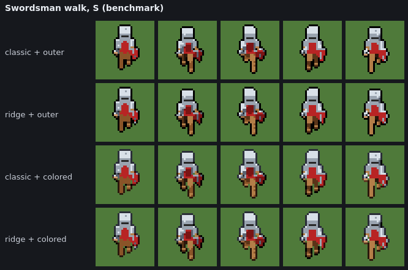

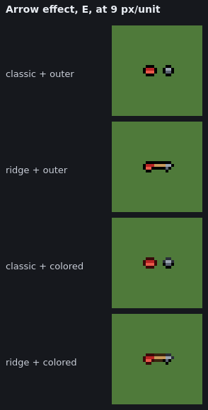 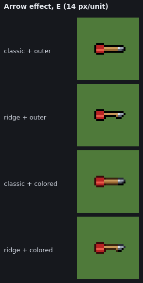

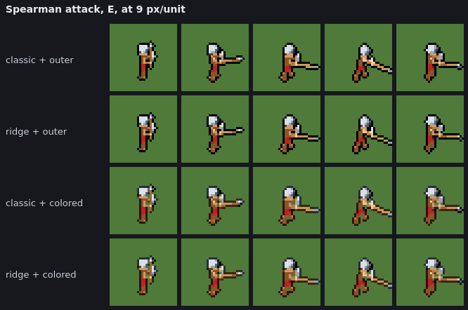

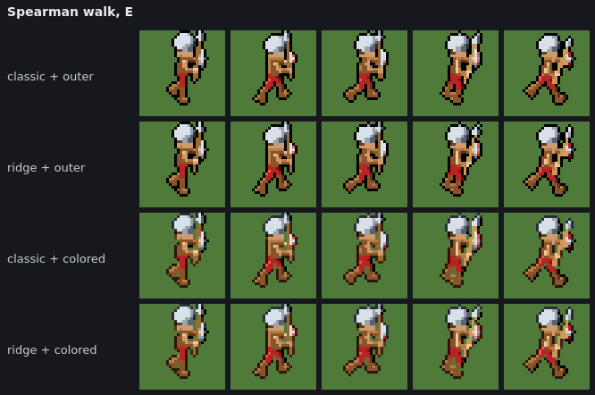

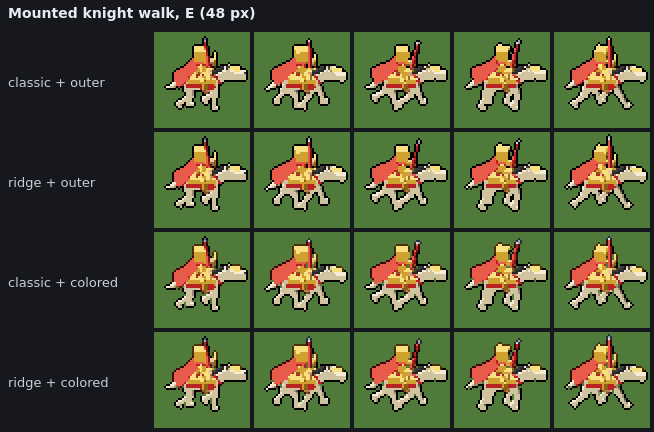

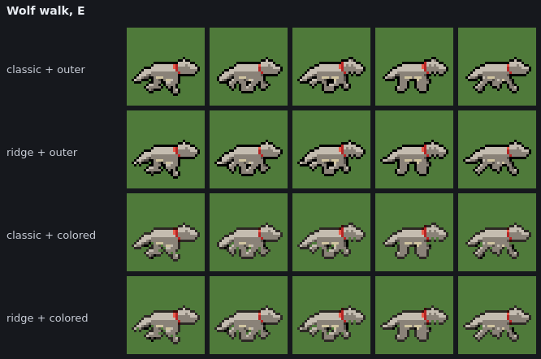

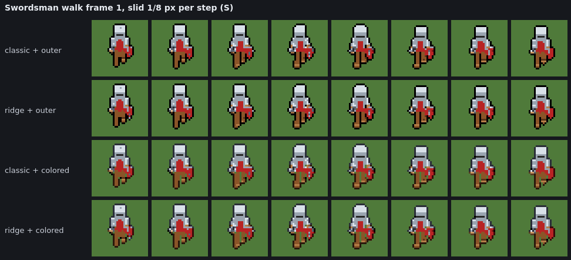

More in [shots/quality/](shots/quality/): the swordsman on sand and dark ground, swordsman E walk and SE attack, archer NE attack, mage S walk, worker SE work, catapult SE walk, and the small spearman's shift test.

What they show:

- **Ridge:** spear shafts, staffs and arrow shafts come out a steady 1 px instead of switching between 1 and 2 (or vanishing at 9 px/unit). Bodies look the same.
- **Colored outline:**
  - Legs, arms and weapons held near the body keep a sliver of ground between them where outer fuses them into one dark mass (most visible on the horse's legs and the walk cycles).
  - The edge is lighter on the lit side and still black on the shadowed side, so the sprite stays clearly bounded.
  - On the preview's checker background, steel's darkest shade matches the checker colour. Judge outlines on the compare view's grounds instead.

## Trade-offs and limitations

- **Ridge**
  - Only changes parts thinner than 1.5 px.
  - A part 1.5–2.5 px wide still flickers between 2 and 3 px as with classic, and one whose width hovers around 1.5 px can switch between the two rules.
  - Very faint lines under half the threshold across (one sample wide at 8×) are still dropped, on purpose.
- **Colored outline**
  - Its colour depends on the neighbour's shade, so shade changes at the edge now also recolour the outline. This is about +5% changing pixels in animation and +11% in the shift test: roughly two thirds from the colour switching, one third from gaps opening and closing.
  - Pale materials always get black.
  - It is a style change: softer than the all-black outer outline by design.

## Recommendation

**Ridge + colored** reads best of the four. Thin parts are consistently 1 px, and the parts they belong to (spears, staffs, arrows) stay connected. Limbs stay apart. The outline keeps the strong black edge on the shadowed side while dropping 70% of the black. It costs about 2× the shading time, which is still a fraction of a render.

- **Ridge** is neutral or better everywhere it was measured. The only regression found is +0.2–1 changed px per step in the shift test, the same as moving a constant-width line. It is a reasonable candidate for a default once the defaults question is settled; a changed default changes old share links.
- **Colored** is a style choice with a measurable flicker cost, so keep it opt-in for now. Two follow-ups worth testing before it becomes a default:
  1. Hysteresis or a ramp-only colour for the outline (always the material's darkest shade, no lit/shadow switch), to cut the colour-switching flicker. *Tested in Part 2 as `stableColored`.*
  2. The black, gap-keeping variant, which keeps most of the readability gain at +3.5% flicker. *Tested in Part 2 as `gapBlack`.*

Further gains in overall flicker need the other proposals in the audit (material vote, interior recolouring), not more work on the silhouette.
p='QUALITY_EXPERIMENTS.md'
s=open(p).read()
def rep(old,new):
    global s
    assert old in s, old
    s=s.replace(old,new,1)
rep("""# Quality experiments: ridge-preserving coverage and the colored outer outline

The first two experiments proposed in [PIPELINE_AUDIT.md](PIPELINE_AUDIT.md) (§4 A and §5 1), implemented as opt-in options and compared against the original pipeline on the same rendered frames.
""","""# Quality experiments: ridge-preserving coverage and outer outlines that keep gaps open

- **Part 1:** the first two experiments proposed in [PIPELINE_AUDIT.md](PIPELINE_AUDIT.md) (§4 A and §5 1), ridge-preserving coverage and the colored outer outline. Both are implemented as opt-in options and compared against the original pipeline on the same rendered frames.
- **[Part 2](#part-2-outline-refinement-temporal-stability-and-gap-preservation):** two refinements of the outline that came out of Part 1, the stable colored outline and the gap-preserving black outline.
""")
rep("""  1. Hysteresis or a ramp-only colour for the outline (always the material's darkest shade, no lit/shadow switch), to cut the colour-switching flicker.
  2. The black, gap-keeping variant, which keeps most of the readability gain at +3.5% flicker.""","""  1. Hysteresis or a ramp-only colour for the outline (always the material's darkest shade, no lit/shadow switch), to cut the colour-switching flicker. *Tested in Part 2 as `stableColored`.*
  2. The black, gap-keeping variant, which keeps most of the readability gain at +3.5% flicker. *Tested in Part 2 as `gapBlack`.*""")
s=s.rstrip('\n')+'\n'+open('/dev/stdin').read()
open(p,'w').write(s)

---

## Part 2: outline refinement, temporal stability and gap preservation

Part 1 found that the colored outline reads better and keeps narrow gaps open, but adds about 5% animation flicker. Part 2 tries two ways to keep its gains without that cost, and compares them with the original outer outline and the colored one on the same frames.

### What was added

| Setting (Sprite folder) | Values | Default |
|-------------------------|--------|---------|
| **outline** | `none`, `inner`, `outer`, `colored`, **`stableColored`**, **`gapBlack`** | `inner` (unchanged) |

- **Nothing existing changed.** `outline()` (inner and outer) and `coloredOutline` are untouched; the golden hashes of the outer outline still pass. Classic and ridge coverage are untouched, so is the 3D rendering and animation timing.
- **Share links:** both values are in `SHARE_CHOICES`, so a link records them like any other outline. Old links render as before. A link using them, opened in an older build, falls back to that build's default outline.
- **Same export formats:** both only choose which palette indices the outline pixels get. `stableColored` outlines team-coloured parts in the team ramp's darkest shade, so they recolour per player.
- Code: [src/render/gapOutline.ts](src/render/gapOutline.ts), dispatched from `shadeStages` in [src/render/postprocess.ts](src/render/postprocess.ts). Tests: [test/gapOutline.test.ts](test/gapOutline.test.ts).

### Stable colored outer (`stableColored`)

The colored outline's ring and gap rule, with every choice made per material instead of per lit pixel:

- **One colour per material.** Each outline pixel takes the **darkest shade of the material** it borders, on the lit side and the shadowed side alike. It never switches to black because the neighbour is in shadow.
- **Computed once, not per pixel.** The colour is a 113-entry table over the palette (`MATERIAL_OUTLINE`), built when the module loads. Every shade of a ramp maps to the same entry, so per pixel the outline is one lookup, and the light can't enter into it. (The colored outline also uses a table, but keyed by shade, which is exactly where its lit/shadow switch comes from.)
- **Pale materials stay black.** Materials whose darkest shade is too light to read as an outline (luma > 0.3: pale skin, bone, holy) always get black. This is still one colour per material, so it is just as stable. Their own darkest shade would be lighter than many grounds, and the palette has no darker colour of the same hue to use instead.
- **Choices between materials are by material.**
  - A pixel bordering two materials takes the darker material's colour, ranked by the material's darkest shade (`MATERIAL_RANK`), not by which neighbour happens to be lit.
  - A 2 px gap is outlined on the darker *material's* side, the left or upper one on a tie. The colored outline goes by the darker *pixel*, so a gap's outlined side could swap as the light moved.
- **Gaps:** otherwise the colored outline's rule, unchanged: 1 px gaps open, 2 px gaps outlined on one side. It is deterministic: the same frame always gives the same outline.

### Gap-preserving black outer (`gapBlack`)

The outer outline's black 4-neighbour ring, but it separates real gaps from ordinary background instead of keeping every narrow gap open:

- **Gaps between separate parts stay open.** A transparent pixel with drawn pixels 1 px away on both sides (or 1 and 2 px: a 2 px gap) along a row or column is a candidate. Its two sides are **separate parts** if they don't join within `DENT_DEPTH` (1) pixels of the gap, along a path through drawn pixels, diagonals included. A separate-parts gap is kept open as the colored outline keeps it: all of it if 1 px wide, one side if 2 px.
- **Dents are outlined.** If the sides do join right beside the gap, the pixel is a **dent**, and it gets outlined as the outer outline would. A dent is either a one-pixel notch in an edge, or the end row of a deeper slit (where two legs meet at the crotch, or an arm meets the body). Those are background, and leaving them open just breaks the black ring. Further down a slit the sides only join a long way round, so the gap stays open.
- **Small holes are left alone.** An enclosed transparent region (one that reaches no edge of the frame, joined along rows and columns) of **up to 4 px** isn't outlined at all; the outer outline turns it into a black blob. Bigger holes (inside a bow, between an arm and the body) are outlined inside like the outer outline, except where they're narrow.
- **Silhouette untouched, thin parts ringed as before.** Drawn pixels never change, and every outline pixel is one the outer outline would also draw. A thin protrusion, such as a spear tip, a tail or an ear, gets the same black ring as with the outer outline.
- **Black only, and independent of the light:** the only material-dependent decision is which side of a 2 px gap is outlined, and that goes by material.

Why depth 1: on the benchmark, the gap between the swordsman's legs is 2 px wide and only 3 rows deep, and the slit between his body and his right arm is 1 px wide and 2 rows deep. At depth 2, `gapBlack` already closes most of both. At depth 1 it outlines only the row where they meet (as the outer outline does) and keeps the rest open, as the colored outline does. Flicker is the same at every depth tried (table below).

### How it was compared

- **Same frames and conditions as Part 1:** the same dumped `FrameSamples` (coverage 0.3, thresholds 0.4 / 0.62 / 0.86, 8× supersampling), all 5 directions. The outlines are compared over **classic** coverage; the over-ridge results are summarised further down.
- **Units:** Part 1's set, plus the **horse** (beast preset, 48 px frame) and a shift test of the **worker** walk. The humanoids with separated limbs are the spearman and worker walks. The other unit types are the wolf, the mounted knight and the catapult.
- **Grounds:** grass `#4f7a3a`, sand `#c8b07a`, dark `#1c1f24`.
- **Diagnostics panel** (`/?diag`): **compare set → outline** shows the four outlines side by side, with every metric below for this direction and for all of them, and the edge contrast against the chosen ground.

New metrics (in `rowStats` / `edgeContrast`, [src/render/diagnostics.ts](src/render/diagnostics.ts)):

| Metric | Meaning |
|---|---|
| outline px recoloured | outline pixels in two consecutive frames whose colour changed: outline colour transitions |
| filled | outline pixels with no empty pixel beside them, other than a 1 px line turning a concave corner: filling a gap or hole rather than edging the sprite, so the outline is thicker than a line |
| bare edges | sides of drawn pixels that face background before outlining and still do after it: the ring broken |
| dents | narrow-gap pixels whose two sides join right beside them (notches, and the end rows of slits) |
| slits | the other narrow-gap pixels: between legs, arm and body, weapon and limb |
| between parts | narrow-gap pixels whose sides don't join within 12 steps at all, so separate parts outright (rare at 32 px) |
| edge contrast | over the final sprite's edge pixels, mean \|luma − ground luma\|, and the share within 0.08 of the ground (lost against it) |

The flicker figures below count **final** pixels (after dithering) per frame step, summed over the rows. Part 1's figures for the shift test counted pixels before dithering, pooled over all steps. Both are given where it matters.

### Results

#### Temporal stability

Pixels changing per frame (and vs outer) · outline pixels recoloured per frame, averaged over 5 directions:

| row | outer | colored | stable colored | gap black |
|---|---|---|---|---|
| **Swordsman walk, S (benchmark)** | 120.6 · 0 | 131.4 (+9.0%) · 9.8 | 124.8 (+3.5%) · 3.6 | 122.4 (+1.5%) · 0 |
| Swordsman walk, all 5 dirs | 138.7 · 0 | 147.0 (+5.9%) · 7.2 | 143.0 (+3.1%) · 4.1 | 139.2 (+0.4%) · 0 |
| **Horse walk (48 px)** | 164.4 · 0 | 170.2 (+3.6%) · 5.9 | 164.6 (+0.1%) · 1.0 | 164.0 (−0.2%) · 0 |
| Spearman walk | 150.8 · 0 | 160.8 (+6.6%) · 8.3 | 157.2 (+4.2%) · 5.6 | 151.2 (+0.3%) · 0 |
| Worker walk | 139.2 · 0 | 148.8 (+6.8%) · 8.1 | 145.1 (+4.2%) · 4.5 | 139.8 (+0.4%) · 0 |
| Wolf walk | 57.8 · 0 | 61.5 (+6.4%) · 2.9 | 58.8 (+1.7%) · 0.3 | 58.1 (+0.6%) · 0 |
| Mounted knight walk (48 px) | 252.0 · 0 | 261.5 (+3.8%) · 7.6 | 259.0 (+2.8%) · 5.8 | 252.2 (+0.1%) · 0 |
| Catapult walk (64 px) | 98.2 · 0 | 104.2 (+6.1%) · 5.1 | 101.2 (+3.1%) · 3.0 | 98.7 (+0.5%) · 0 |
| Swordsman frame 1, shifted | 39.1 · 0 | 43.4 (+10.8%) · 2.9 | 42.1 (+7.4%) · 1.9 | 40.4 (+3.1%) · 0 |
| Horse frame 1, shifted | 53.0 · 0 | 57.4 (+8.2%) · 3.0 | 55.3 (+4.4%) · 1.3 | 53.5 (+1.0%) · 0 |
| Worker frame 1, shifted | 35.9 · 0 | 39.8 (+10.8%) · 2.6 | 38.3 (+6.8%) · 1.5 | 36.9 (+2.8%) · 0 |

Over all rows:

| | outer | colored | stable colored | gap black |
|---|---|---|---|---|
| animation, 21 unit rows: px changing per frame | 3330 | +3.6% | +1.9% | **+0.2%** |
| animation: outline px recoloured per frame | 0 | 112 | 64 | **0** |
| shift test, 14 rows | 803 | +7.0% | +4.0% | **+1.2%** |
| shift test, Part 1's measure (before dithering, pooled) | 42.6 / step | +10.8% | +6.3% | **+2.3%** |
| animation, Part 1's measure | 149.4 / step | +4.1% | +2.1% | **+0.2%** |
| 9 px/unit, animation | 590 | +7.3% | +4.6% | **+0.7%** |
| 9 px/unit, shift test (Part 1's measure) | 23.2 / step | +15.7% | +9.7% | **+2.7%** |

**The +3.5% claim holds, and `gapBlack` does better.** Measured as Part 1 measured it, a black outline using the colored outline's gap rule comes out at **+3.4%** in the shift test (Part 1: +3.5%). `gapBlack` comes out at **+2.3%**, because it outlines dents again. In real animation every black, gap-keeping variant is within **+0.2–0.6%** of outer. The shift test is pure sub-pixel aliasing, the worst case, which is where the remaining 1–3% shows.

Where the colored outline's extra flicker comes from (animation, px changing per frame, all 21 rows):

| step | px / frame | vs outer |
|---|---|---|
| outer | 3330 | |
| + keep gaps open (colored's gap rule, all black) | 3344 | +14 |
| + colour each outline pixel by the material it borders | 3398 | +54 |
| + switch to black next to shadowed pixels (= colored) | 3451 | +53 |
| stable colored (the colored outline without the switch, choices by material) | 3392 | +62 |
| gap black | 3335 | +5 |

- **Stable colored removes the lit/shadow switch** (−53 px/frame, and outline recolours drop from 112 to 64 per frame), but only halves the extra flicker.
- **The rest is inherent to colouring by material.** As a leg passes in front of the torso, or an arm in front of a cloak, the outline pixels beside them border a different material and change colour. A black outline has nothing to change.

#### Gap preservation and outline thickness

Per frame, averaged over directions: slits open / slits · dents open / dents · edge sides left bare · filled outline px:

| row | outer | colored | stable colored | gap black |
|---|---|---|---|---|
| **Swordsman walk, S (benchmark)** | 0/4.0 · 0/3.8 · 0% · 6.0 | 2.4/4.0 · 3.2/3.8 · 15% · 0.0 | 2.4/4.0 · 3.2/3.8 · 15% · 0.0 | **2.4/4.0 · 0.6/3.8 · 7% · 1.4** |
| **Horse walk** | 0/3.3 · 0/5.5 · 0% · 4.3 | 1.9/3.3 · 4.2/5.5 · 10% · 0.0 | 1.9/3.3 · 4.2/5.5 · 10% · 0.0 | **1.9/3.3 · 0.9/5.5 · 4% · 1.2** |
| Spearman walk | 0/5.7 · 0/6.6 · 0% · 7.1 | 3.7/5.7 · 5.2/6.6 · 18% · 0.1 | 3.7/5.7 · 5.2/6.6 · 19% · 0.1 | **3.7/5.7 · 1.7/6.6 · 10% · 1.2** |
| Worker walk | 0/4.9 · 0/5.6 · 0% · 5.1 | 2.8/4.9 · 4.2/5.6 · 15% · 0.0 | 2.8/4.9 · 4.2/5.6 · 14% · 0.0 | **2.8/4.9 · 0.7/5.6 · 6% · 1.1** |
| Wolf walk | 0/0.6 · 0/3.6 · 0% · 1.3 | 0.4/0.6 · 2.5/3.6 · 10% · 0.0 | 0.4/0.6 · 2.5/3.6 · 10% · 0.0 | **0.4/0.6 · 0.6/3.6 · 3% · 0.4** |
| Mounted knight walk | 0/5.1 · 0/9.2 · 0% · 7.5 | 3.0/5.1 · 7.2/9.2 · 14% · 0.0 | 3.0/5.1 · 7.2/9.2 · 14% · 0.0 | **3.0/5.1 · 2.0/9.2 · 6% · 1.8** |
| Catapult walk | 0/1.8 · 0/7.9 · 0% · 4.7 | 0.9/1.8 · 5.8/7.9 · 11% · 0.0 | 0.9/1.8 · 5.6/7.9 · 11% · 0.0 | **0.9/1.8 · 2.2/7.9 · 5% · 2.6** |

(A slit 2 px wide counts as half open when one side is outlined, so "open" tops out below the total.)

- **`gapBlack` keeps exactly the slits the colored outline keeps open** (56 of 93 slit pixels per frame over all rows, the same as colored). It also keeps every gap between outright separate parts open (5 of 8, the rest being the outlined half of 2 px gaps).
- **It closes 72% of the dents the colored outline leaves open.** That is where it differs, and it is what makes its ring continuous: it leaves 6% of edge sides bare against colored's 14%.
- **Thickness:**
  - Outer fills 118 px/frame of gaps and holes with black: a 2 px black bar between legs, small holes turned into blobs.
  - `gapBlack` fills 27, the dents it closes on purpose.
  - Colored fills 1, but leaves 330 edge sides bare against `gapBlack`'s 150.
- **The silhouette and thin parts are identical in all four**, by construction (tested): the outlines only add pixels outside the silhouette. Thin-feature persistence is set by the coverage step (Part 1: ridge), not the outline.

Effect of the parameters on `gapBlack` (animation, all 21 rows, per frame):

| | filled | bare edges | gaps open | changing |
|---|---|---|---|---|
| outer | 118 | 0 | 4 | 3330 |
| dent depth 6 | 91 | 82 | 35 | 3336 |
| dent depth 4 | 78 | 92 | 43 | 3336 |
| dent depth 3 | 67 | 102 | 51 | 3336 |
| dent depth 2 | 51 | 118 | 62 | 3337 |
| **dent depth 1 (chosen)** | 27 | 150 | 82 | 3335 |
| depth 1, holes filled | 27 | 149 | 81 | 3335 |
| depth 1, holes up to 8 px kept | 27 | 156 | 85 | 3335 |

The flicker doesn't depend on the depth, so the depth is purely a style choice: how far down a slit the outline closes it. Enclosed holes are rare at 32 px (about 1 px per frame over all rows); their rule matters for bigger frames and for weapons held across the body.

#### Silhouette readability

Edge contrast against the ground, mean \|Δluma\| over the final edge pixels, on grass · sand · dark, with the share of edge pixels lost on the dark ground (within 0.08 of it):

| row | outer | colored | stable colored | gap black |
|---|---|---|---|---|
| Swordsman walk | 0.40 · 0.69 · 0.12 (0%) | 0.27 · 0.52 · 0.12 (63%) | 0.24 · 0.50 · 0.10 (83%) | 0.39 · 0.66 · 0.15 (0%) |
| Horse walk | 0.40 · 0.69 · 0.12 (0%) | 0.29 · 0.57 · 0.07 (69%) | 0.27 · 0.55 · 0.05 (86%) | 0.39 · 0.68 · 0.13 (0%) |
| Spearman walk | 0.40 · 0.69 · 0.13 (0%) | 0.27 · 0.52 · 0.13 (50%) | 0.23 · 0.48 · 0.11 (74%) | 0.37 · 0.64 · 0.15 (1%) |
| Worker walk | 0.38 · 0.68 · 0.12 (2%) | 0.28 · 0.54 · 0.13 (33%) | 0.25 · 0.51 · 0.12 (46%) | 0.37 · 0.65 · 0.13 (2%) |
| Wolf walk | 0.40 · 0.69 · 0.12 (0%) | 0.26 · 0.52 · 0.09 (75%) | 0.24 · 0.50 · 0.08 (90%) | 0.39 · 0.68 · 0.13 (0%) |
| Mounted knight walk | 0.40 · 0.69 · 0.12 (0%) | 0.33 · 0.57 · 0.16 (22%) | 0.32 · 0.55 · 0.15 (29%) | 0.39 · 0.66 · 0.15 (0%) |
| Catapult walk | 0.40 · 0.69 · 0.12 (0%) | 0.27 · 0.52 · 0.11 (67%) | 0.23 · 0.49 · 0.09 (87%) | 0.38 · 0.66 · 0.14 (0%) |

- **On grass and sand:** both black outlines bound the sprite much more strongly. `gapBlack` is within 0.01–0.05 of outer; the small drop is the lit pixels that now border the open gaps.
- **On dark ground:** the material colours vanish. Most darkest shades sit within 0.08 luma of `#1c1f24`, so half to nine tenths of a colored or stable-colored sprite's edge is lost. Black is only 0.12 from that ground, but it stays a distinct edge. `gapBlack` has the best dark-ground contrast of the four, because its open gaps show lit pixels, which stand out there.
- **Stable colored reads slightly worse than colored** everywhere: the black it drops on the shadowed side was helping.

#### Over ridge coverage

The same ordering holds over ridge coverage (animation: outer 3331, colored +3.6%, stable +1.8%, gap black +0.1%; shift test: 811, +7.3%, +4.2%, +1.2%). The outlines and ridge coverage are independent.

#### Performance

Outline step alone, and whole shading per frame (Node, this machine; 120 real 32 px swordsman frames, synthetic frames for the bigger sizes):

| | outline step, 32 px | whole shading, 32 px | outline step, 64 px | 128 px | 256 px |
|---|---|---|---|---|---|
| outer | 9.5 µs | 28 µs | 27 µs | 102 µs | 0.40 ms |
| colored | 24 µs | 43 µs | 70 µs | 233 µs | 0.95 ms |
| stable colored | 24 µs | 44 µs | 64 µs | 250 µs | 1.0 ms |
| gap black | 46 µs | 63 µs | 100 µs | 373 µs | 1.7 ms |

`gapBlack` costs about half its time on finding the enclosed holes (a flood fill of the background). The search for where a gap's sides join only runs at narrow-gap pixels, and only a few steps. Reshading a ~300-frame sheet at 32 px goes from about 9 ms (outer) to about 19 ms. It is post-processing only: rendering is unaffected.

### Visual comparison

Rows, top to bottom: **outer, colored, stable colored, gap black**. All over classic coverage, at 4× (3× for the 48 px units, 2× for the catapult).

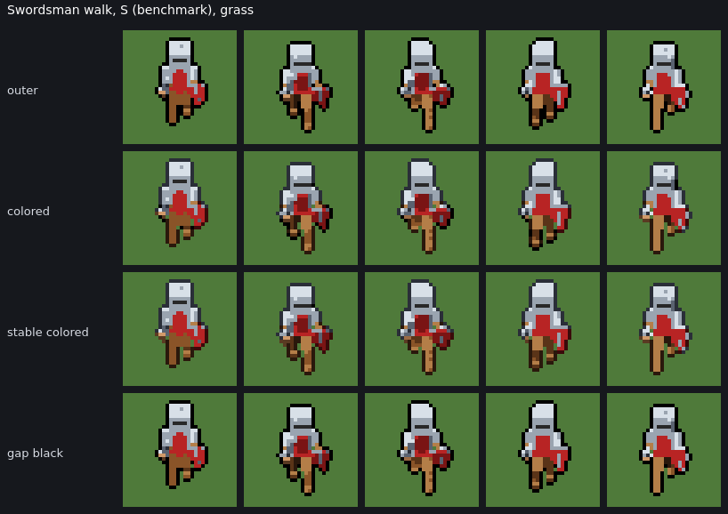

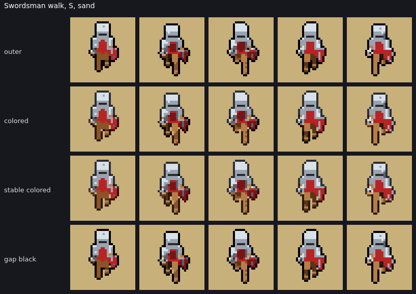

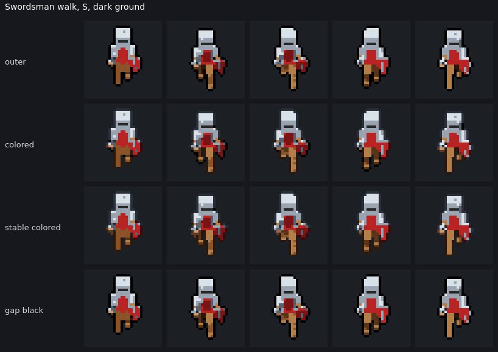

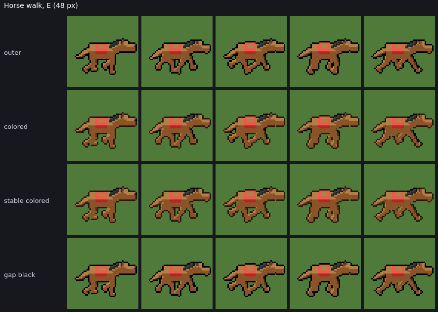

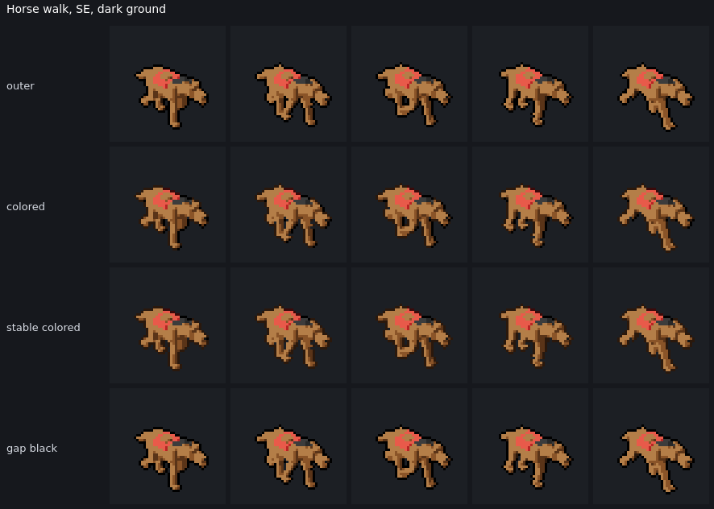

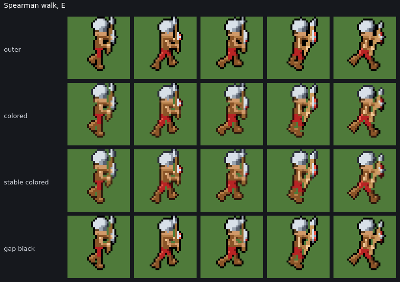

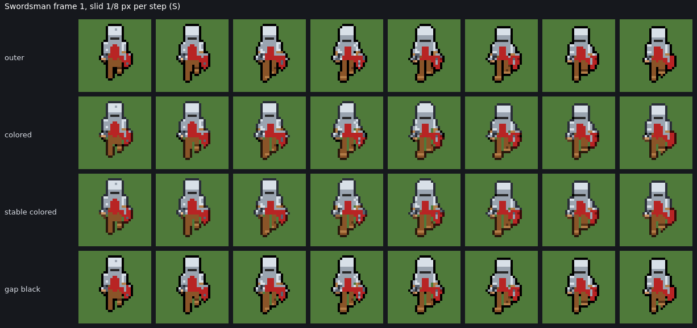

More in [shots/outline/](shots/outline/): the worker on sand, the wolf on dark ground, the mounted knight and the catapult.

What they show:

- **Gap black looks like the outer outline with the gaps opened.** Ground shows between the swordsman's and the spearman's legs below the crotch, between the spear shaft and the body, and between the horse's legs. Everywhere else it is the same strong, continuous black line.
- **Colored and stable colored are softer**, and on the swordsman's steel the lit-side outline is close to the armour itself.
  - On dark ground both all but disappear: the steel, leather and fur outlines merge with the ground.
  - Stable colored also loses the black on the shadowed side, which flattens the sprite slightly.
- **Stable colored versus colored:** the outline under a limb no longer flips between black and colour as the limb turns. It still changes colour where a different part passes in front, which is visible on the spearman's arm.

### Known limitations

- **`gapBlack`**
  - A meaningful gap only 1 row deep, a part touching another for a single row, counts as a dent and is outlined. At 32 px this only happens at the very end of a slit.
  - A slit's two sides are told apart only by where they join, not by what they are: a deep notch in a single part, which these sprites don't have, would be kept open like a gap between legs.
  - Holes are decided by size alone; a 4 px hole that is meant to read (a ring, a helmet's eye slit seen edge-on) stays background, not outlined.
  - It costs about 2× the outer outline's time, but this is negligible next to rendering.
- **`stableColored`**
  - It still recolours outline pixels as parts pass in front of each other, inherent to any per-material colour, so it is still +2–4% flicker.
  - It loses edges on dark ground and reads more softly than colored.
  - Pale materials (pale skin, bone, holy) always get black, so a unit can have a mixed outline.
  - Team colours with a pale darkest shade (the `white` team, `#6a6a72`) outline lighter than the base palette suggests; this applies to colored too.
- **Both**
  - The 2 px gap rule picks a side by material, then left or upper. For two parts of one material, that side doesn't follow the parts as they cross over.
  - The edge-contrast metric is luma only. It doesn't see hue contrast, which does help the coloured outlines a little on grass.

### Recommendation

**For classic RTS-style pixel art, use `gapBlack`.**

- **Stability:** it is the only refinement that is essentially free in temporal terms, +0.2% changed pixels in animation and +1–3% in the sub-pixel shift test, and it never recolours an outline pixel.
- **Readability:** it keeps the original outer outline's strong, continuous black edge on every ground: best contrast on dark ground, near-best on grass and sand.
- **Gaps:** it keeps open exactly the gaps between legs, arms and weapons that the colored outline keeps, without its ragged notches or the outer outline's black bars and blobs.

Paired with ridge coverage it gives thin parts that stay 1 px and limbs that stay apart, at about 2× the shading time of the original.

- **`stableColored`** answers the question of determining the colour once per material: it can be, as a palette-sized table, and that removes the lit/shadow switch (−43% outline recolours, half of colored's extra flicker). But a per-material colour still flickers more than black as parts overlap, and it loses the silhouette on dark ground. Keep it, like colored, as an opt-in style for softer, non-RTS looks.
- **Defaults are unchanged.** If `gapBlack` (with ridge) is made the default later, links that relied on the old default will render differently; that is the same consideration as in Part 1.
